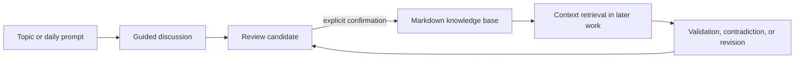

# Cognition Workbench

[简体中文](README.zh-CN.md) · [Documentation](docs/) · [Contributing](CONTRIBUTING.md) · [Security](SECURITY.md)

A local-first cognition system for Codex. It turns guided discussions into reviewable knowledge, recalls relevant judgments in later work, and keeps external evidence separate from personal conclusions.

## Why it exists

Most knowledge bases preserve information. Cognition Workbench preserves how a judgment was formed, what supports or challenges it, how confident it is, and when it should be reconsidered.

The first release provides three connected workflows:

- **Guided discussion** — explores one branch and asks one question at a time.
- **Contextual recall** — retrieves relevant prior cognition during AI, product, strategy, and implementation work.
- **Daily topic** — proposes one high-value issue without starting the discussion automatically.

All formal knowledge stays in local Markdown. New conclusions enter a review inbox and are committed only after explicit confirmation.



## Quick start

Requirements: [Node.js](https://nodejs.org/) 20 or newer, Codex, and Git.

```bash
git clone https://github.com/to-real/cognition-workbench.git
cd cognition-workbench
npm ci
npm run install:dry-run
npm run install:codex
```

Restart Codex after installation. The installer links the three bundled skills and registers the local MCP server. It derives every path from the checkout, refuses to replace unrelated files, and supports `--force` only for replacing the existing MCP registration.

Then try:

```text
Let's discuss whether AI agents will replace traditional enterprise software.
Recommend today's topic.
Evaluate whether this AI office product has a durable moat.
Use my previous judgments about workflow switching costs.
```

Chinese is the default discussion language in the bundled skills, but their instructions can be adapted.

## What is included

| Area | Purpose |
| --- | --- |
| `skills/` | Guided discussion, contextual recall, and daily-topic workflows |
| `server/` | Local MCP tools for retrieval, relationships, review, and daily topics |
| `knowledge/` | Your formal topics, cognition units, sources, and project records |
| `inbox/` | Unconfirmed updates and daily topic proposals; ignored by Git |
| `templates/` | Human-editable Markdown record templates |
| `examples/` | Non-personal sample knowledge, kept outside the live knowledge base |
| `docs/` | Product model, usage, architecture, and development notes |

## Design boundaries

- Markdown is the source of truth; generated state is disposable.
- Personal judgment and external evidence are distinct record types.
- Retrieval combines title, body, categories, tags, status, and explicit links.
- Obsolete cognition is retained as history and excluded from default guidance.
- No vector database, hosted account, or external analytics is required.

See [Architecture](docs/architecture.md), [Knowledge model](docs/knowledge-model.md), and [Usage](docs/usage.md) for details.

## Development

```bash
npm ci
npm test
```

The test suite covers retrieval ranking, relationship expansion, review-before-write behavior, version history, the daily topic constraint, portable installation planning, and a real MCP client/server exchange.

## Status

`v0.1.0` is an intentionally small local-first release. Semantic retrieval, richer contradiction detection, and a dedicated interface are future options, not runtime requirements.

## License

[MIT](LICENSE)
