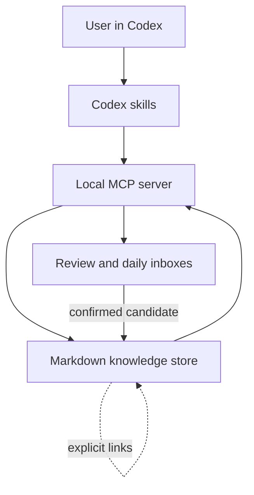

# Architecture

## Components

### Codex skills

The skills define conversational behavior: incremental discussion, proactive retrieval, source boundaries, and explicit confirmation. They contain no user-specific filesystem paths.

### MCP server

The Node.js MCP server exposes retrieval, relationship traversal, knowledge status, update candidates, confirmation, and daily-topic tools over standard input/output. `COGNITION_WORKBENCH_HOME` selects the data root; otherwise the server uses the repository root.

### Markdown store

Markdown with YAML frontmatter is the source of truth. The store loads records at request time, scores text and metadata matches, applies cognition-status weights, and expands explicit relationships. The architecture intentionally avoids a database in the first release.

### Review inbox

Writes use a two-step protocol. A candidate is first written under `inbox/updates/`; the confirmation tool then creates or revises the formal record. Revisions archive the preceding version under `knowledge/history/`.

## Trust boundaries

- The system runs locally and does not include telemetry.
- External research is performed by the host agent, not by the MCP server.
- Retrieved cognition is context, not verified external fact.
- Only the exact literal `CONFIRMED` allows a candidate to become formal knowledge.
- Inbox and generated state are excluded from version control by default.

## Retrieval model

The initial ranker tokenizes Latin terms and overlapping Chinese bigrams, then scores title, tags, categories, and body with different weights. Status weights lower disputed or obsolete records. Context building expands links from the best topic and cognition matches, then presents personal judgment and sources separately.
